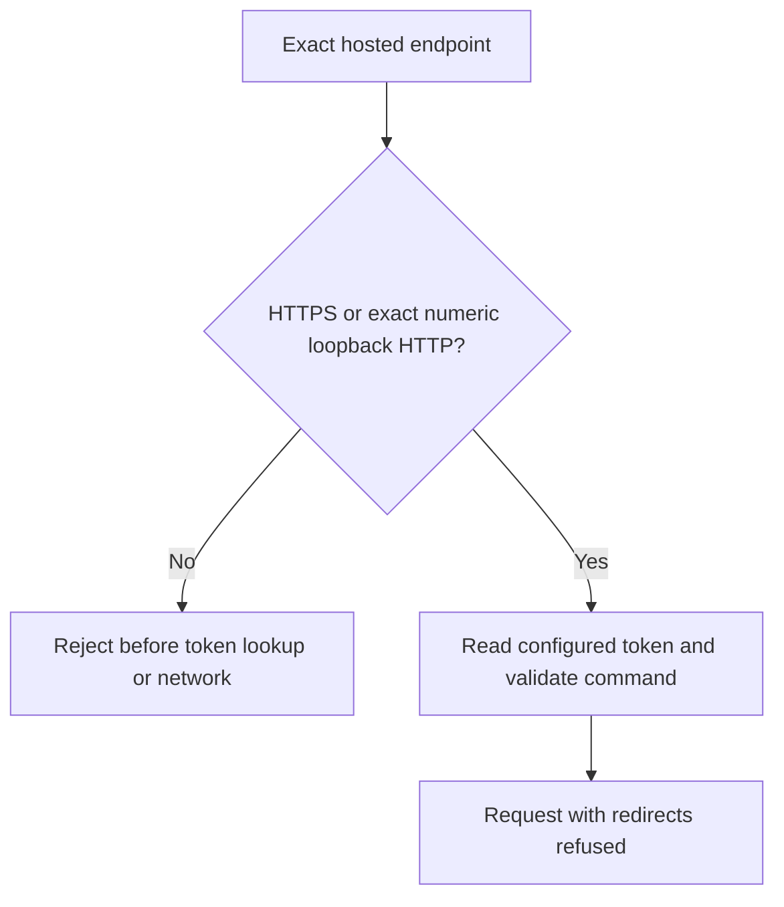

# Require HTTPS for non-loopback proposal CLI routes

Related: [#10](https://github.com/barocss/doc-sync/issues/10).
Baseline: `0904977`.

The creator planner client already required HTTPS outside exact numeric loopback.
The separate proposal CLI accepted an arbitrary HTTP endpoint and would attach
its configured bearer token. A synthetic fetch regression reproduced that path
without an external request or real credential.

All proposal CLI commands now reject plaintext routes outside `127.0.0.1` and
`[::1]` **before reading the token environment property or opening input files**.
HTTPS remains allowed, existing exact hosted-route validation remains, and fetch
still refuses redirects. DNS `localhost`, other numeric addresses and mapped
IPv6 are deliberately not added as exceptions, matching the creator client.
A caller needing a non-loopback endpoint must configure HTTPS; no automatic URL
rewriting or silent fallback is performed.

The explanatory diagram below describes validation, not an actual UI capture:

Verification on Node 24.22.1:

- Before fix: plaintext-remote rejection test FAIL, allowed-route test PASS.
- After fix: both new cases PASS; rejected cases perform zero credential reads
  and zero fetch calls. Allowed HTTPS and IPv4/IPv6 loopback calls use mock fetch.
- Existing real local proposal CLI/owner acceptance/hosted planner cases plus
  new tests: **8/8 PASS**.
- TypeScript no-emit and `git diff --check`: PASS.

This does not prove server identity beyond normal HTTPS handling, encrypt local
loopback, alter permissions, or authorize any real provider/remote request.
Existing protect-text WIP and live-provider HOLD are excluded. Exact-commit CI
and final review are recorded in the issue; #10 remains open for separate gates.
