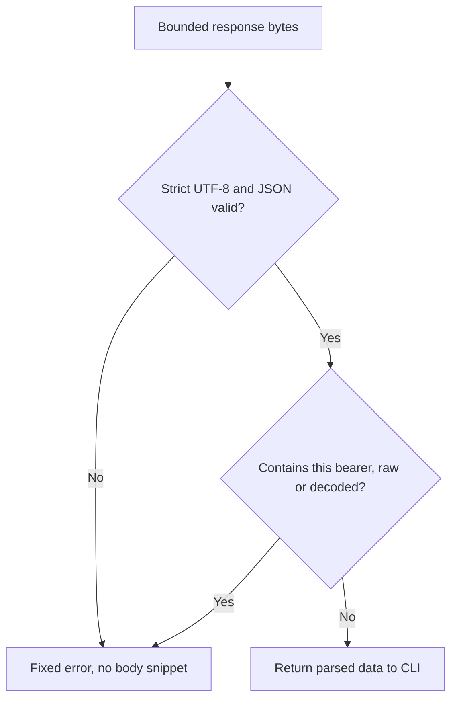

# Proposal CLI input and output integrity

Related: [#10](https://github.com/barocss/doc-sync/issues/10).
Baseline: `072b665`.

The owner proposal CLI returned decoded response objects directly to its caller,
which prints them. Unlike the creator client, it did not reject its own bearer
being echoed in a response. JSON syntax errors from local input or responses
also escaped directly and could include a snippet of the original text.
Both byte boundaries silently repaired invalid UTF-8 before parsing JSON.

The CLI now decodes bounded bytes strictly, uses fixed JSON error messages, and
rejects raw or JSON-escaped bearer reflections before returning the object.
Normal Unicode, including Korean, emoji and intentional U+FFFD, remains valid.
The existing BOM rejection, byte limits, file ownership checks, transport,
endpoint validation and owner decision requirements are preserved.

This explanatory diagram describes the actual response path, not a UI capture:

A private input JSON failure likewise stops before fetch with a fixed message.
A response failure may follow a server-side action; **it is not proof that an
operation was not applied**. Keep the original request/decision identity and
use existing inspection/reconciliation rather than inventing a fresh request.

## Verification

- Baseline: new 3-case suite fails. The error actually includes synthetic
  `PRIVATE_DIAGNOSTIC`; a synthetic echoed token is returned instead of rejected.
- After: all three cases pass, including escaped reflection, invalid UTF-8,
  fixed errors, no fetch after input failure, and normal Unicode round trips.
- Related CLI/transport/owner-acceptance/real local hosted planner: **11/11 PASS**.
- TypeScript no-emit and `git diff --check`: PASS.

All tokens and remote responses were synthetic. No real remote/model call or
credential inspection occurred. This detects only the current bearer in raw or
JSON-decoded form, not arbitrary secrets, encodings or all transport errors.
Held protect-text WIP is unchanged and excluded. Exact-commit CI and independent
review are recorded in the issue. This does not close #10's live-provider gates.
