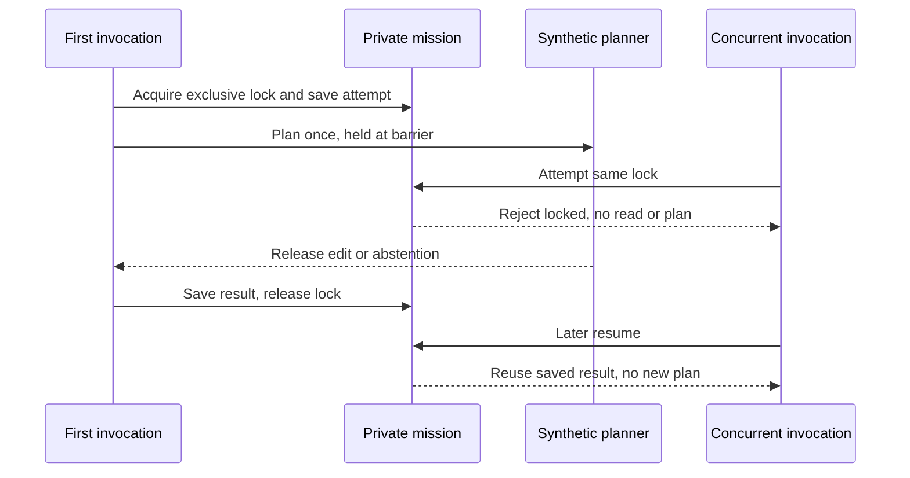

# Same-mission planning contention

Related: [issue #10](https://github.com/barocss/doc-sync/issues/10).
Source baseline: `3b897cf`. This is additional synthetic regression evidence,
not a product runtime change, real model evaluation, or completed issue #10.

## Verified behavior

Two new tests hold the first planner behind an explicit promise barrier. A
second invocation for the same private mission must fail on the exclusive lock
before reading a target, calling a planner, creating a proposal, or changing the
durable planning-attempt record. After releasing the barrier, separate cases
cover a recorded proposal and terminal abstention. A later invocation reuses
the saved result without another read, plan or create.

The following is an explanatory sequence diagram, **not a captured UI**:

## Checks

- Node 24.22.1: new contention cases **2/2 PASS**.
- Combined mission contention, model boundary, provider adapter, durable attempt
  and private inspection suites: **46/46 PASS**, 0 failed/skipped/cancelled.
- `git diff --check`: PASS.
- The default shell Node 18 cannot load TypeScript tests; its initial invocation
  failed before test admission. The installed required Node 24 was used above.

No external model request, credential read, document write, owner approval,
public service deployment or long-load test occurred. The client/provider are
synthetic. This is same-process concurrent invocation with real private files;
it is not new multi-process crash or cross-host locking proof. Existing
`--protect-text` work is untouched and excluded from this change.
