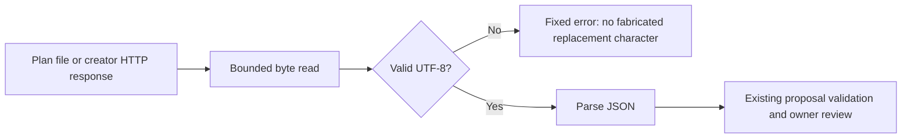

# Reject malformed UTF-8 at proposal input boundaries

Related: [#10](https://github.com/barocss/doc-sync/issues/10).
Reproduction baseline: `deec9c1`.

## Problem and bounded fix

The prepared-plan reader and creator response parser used `Buffer.toString`,
which silently replaces malformed UTF-8 bytes with U+FFFD. JSON could then parse
successfully even though its text no longer matched the supplied bytes. These
boundaries now use a fatal UTF-8 decoder and preserve their existing fixed error
messages. Decoding occurs only after the already bounded byte read, so multibyte
characters split across HTTP writes remain valid. `ignoreBOM: true` preserves a
leading BOM for JSON parsing to reject, retaining prior behavior.

This explanatory diagram describes the real input path; it is not a UI capture:

Normal Korean text, emoji and an intentionally encoded U+FFFD remain supported.
No conflict policy, document schema, proposal authority or provider configuration
changed. The creator client still leaves structural target validation to its
existing mission caller; this patch does not add a new schema guarantee.

## Verification

- Before the fix: both new boundary tests failed with missing expected rejection.
- After: both tests pass for invalid continuation, lone continuation, truncated
  multibyte and overlong byte sequences, plus valid Unicode and BOM controls.
- Focused input/client/planner/real local hosted suites: **12/12 PASS**.
- Full local bot suite: **268/268 PASS**. This checkout also contains separately
  held `--protect-text` work; that work is neither modified nor published here.
- TypeScript `tsc -p tsconfig.json --noEmit` and `git diff --check`: PASS.
- Independent read-only review: no confirmed blocker.

Node 24.22.1 was used. There was no real model invocation, credential inspection,
long-load run or UI behavior change. Exact published-commit CI is tracked in the
issue; local results do not substitute for that gate. Issue #10 remains open for
its separate live-provider and orchestration requirements.
